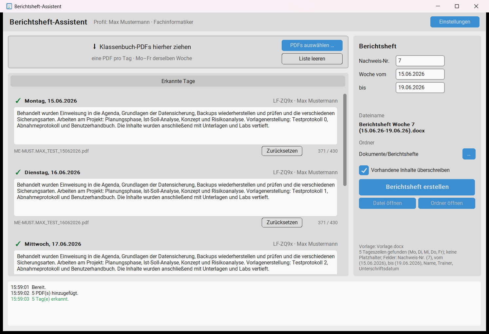
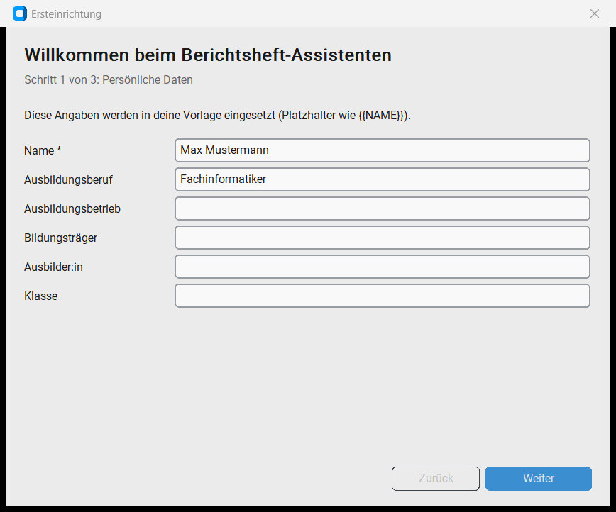
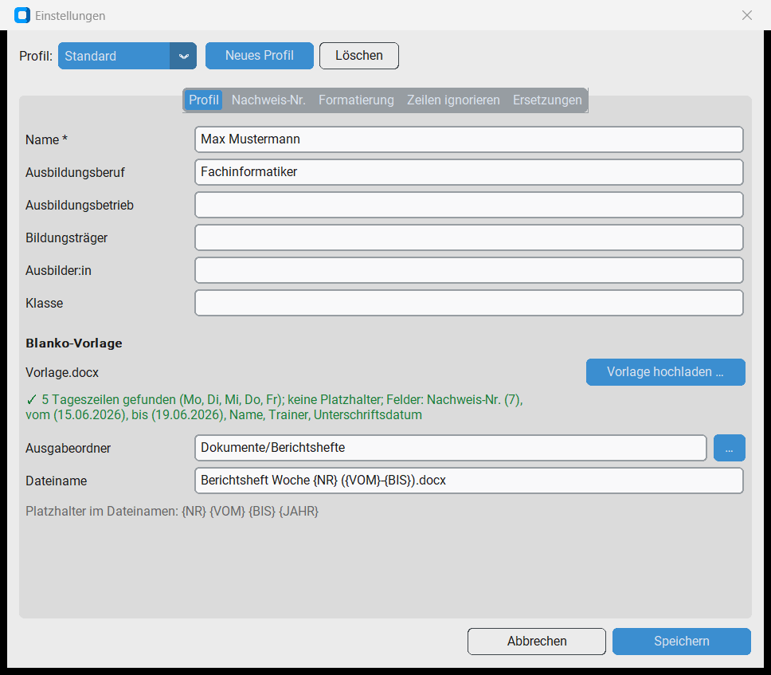

# Berichtsheft-Assistent

Eine Windows-App für Umschüler:innen und Azubis: Sie macht aus den **Klassenbuch-PDFs** (GFN-„Themendokumentation“) in wenigen Klicks ein fertiges **Berichtsheft (Word)**.

1. Beim ersten Start persönliche Daten eintragen und die eigene Blanko-Vorlage hochladen
2. Jede Woche die PDFs ins Fenster ziehen
3. Vorschau prüfen, Texte bei Bedarf anpassen, auf **„Berichtsheft erstellen“** klicken



---

## Installation

1. Unter [Releases](../../releases) die Datei **`Berichtsheft-Assistent.exe`** herunterladen.
2. Die Datei an einen beliebigen Ort legen (z. B. Desktop) und per Doppelklick starten.
   Python muss **nicht** installiert sein.
3. Falls Windows SmartScreen warnt („Der Computer wurde durch Windows geschützt“):
   **Weitere Informationen → Trotzdem ausführen**. Die EXE ist nicht signiert, deshalb diese Warnung.

## Erste Schritte

Beim ersten Start öffnet sich der **Einrichtungs-Assistent**:

| Schritt | Was passiert |
|---|---|
| Persönliche Daten | Name, Ausbildungsberuf, Betrieb, Bildungsträger, Ausbilder:in, Klasse |
| Blanko-Vorlage | Deine leere Berichtsheft-`.docx` hochladen. Die App kopiert sie in ihren Datenordner und meldet, was sie erkannt hat, z. B. *„5 Tageszeilen gefunden; Felder: Nachweis-Nr., vom, bis“* |
| Nachweis-Nr. & Ablage | Wie die Nummer weiterzählen soll (siehe unten) und wohin die fertigen Dateien kommen |



### Jede Woche

1. Die Klassenbuch-PDFs der Woche (eine pro Tag) in das obere Feld ziehen **oder** auf „PDFs auswählen …“ klicken. Ganze Ordner gehen auch.
2. Für jeden erkannten Tag siehst du Datum, Lernfeld, Dozent:in und den Status (✓ / ⚠).
3. Den Text in den Feldern kannst du direkt ändern. Der Zähler zeigt die Zeichen, mit „Zurücksetzen“ kommt der generierte Text zurück.
4. Nachweis-Nr. und Zeitraum sind schon ausgefüllt und lassen sich ändern. Darunter siehst du den Dateinamen, z. B.
   `Berichtsheft Woche 55 (29.06.26-03.07.26).docx`.
5. **Berichtsheft erstellen** klicken, danach **Datei öffnen** oder **Ordner öffnen**.

Die App warnt, wenn PDFs aus verschiedenen Wochen, doppelte Tage oder Wochenenden dabei sind. Eine kaputte PDF wird gemeldet, die übrigen werden trotzdem verarbeitet.

### Nachweis-Nr.

- **Letzte Nr. +1 pro Woche:** Die App merkt sich, welche Nummer für welche Woche zuletzt erstellt wurde. Liegen Wochen dazwischen (Urlaub), zählt sie entsprechend weiter.
- **Aus dem Ausbildungsbeginn:** Die Woche des Ausbildungsbeginns ist Nr. 1, jede weitere Kalenderwoche +1.
- **Aus der Vorlage:** Die Nummer, die in der Vorlage steht.

## Einstellungen

Erreichbar über **Einstellungen** oben rechts:



- **Profil:** persönliche Daten, Vorlage, Ausgabeordner, Muster für den Dateinamen (`{NR}`, `{VOM}`, `{BIS}`, `{JAHR}`)
- **Formatierung:** Schriftgröße und Fettdruck für Tagestext und Lernfeld, maximale Zeichen pro Tag (Standard 430). Schriftgröße `0` bedeutet: so wie in der Vorlage.
  Außerdem lässt sich einstellen, ob Nachweis-Nr., Zeitraum, Name und Dozent:in in die Kopfzeilen geschrieben werden, ob das Lernfeld eingetragen wird, ob das Datum bei der Unterschrift gesetzt wird und was in der Spalte „Std.“ steht.
- **Zeilen ignorieren:** Zeilen aus dem Klassenbuch, die nie im Bericht landen sollen. Dozent:innen werden **automatisch** herausgefiltert.
  Daneben steht eine Liste mit Stichwörtern, die beim Kürzen zuerst wegfallen (Agenda, Wiederholung …).
- **Ersetzungen:** Tabelle *falsch → richtig* für Tippfehler aus dem Klassenbuch (z. B. „Grundllagen“ → „Grundlagen“). Ersetzt werden nur ganze Wörter.
- **Mehrere Profile** sind möglich, z. B. wenn sich zwei Personen einen Rechner teilen.

## Eigene Vorlage mit Platzhaltern

Die App findet in deiner Vorlage automatisch:

- **Tageszeilen:** Zeilen einer Tabelle, deren erste Zelle `Mo`, `Di`, `Mi`, `Do` oder `Fr` ist (auch `Montag` …). Der Text kommt in die breiteste Zelle der Zeile, das Lernfeld in die Spalte mit der Überschrift „Lernfeld“.
- **Kopffelder:** die Zelle rechts neben „Ausbildungsnachweis Nr.“, „… vom“, „bis“ und „Name des/der Auszubildenden“ sowie die Zelle „Trainer/Ausbilder: …“
- **Unterschriftsdatum:** das Datum in der Zeile über „… Unterschrift …“

Wenn deine Vorlage anders aufgebaut ist, schreibst du **Platzhalter** an die gewünschten Stellen, auch in Kopf- und Fußzeilen:

| Platzhalter | Inhalt |
|---|---|
| `{{NAME}}` `{{BERUF}}` `{{BETRIEB}}` `{{BILDUNGSTRAEGER}}` `{{AUSBILDER}}` `{{KLASSE}}` | aus deinem Profil |
| `{{NACHWEIS_NR}}` | Nachweis-Nr. |
| `{{VOM}}` `{{BIS}}` | Montag/Freitag der Woche (TT.MM.JJJJ) |
| `{{JAHR}}` | Jahr der Woche |
| `{{DATUM}}` | letzter Unterrichtstag (für die Unterschrift) |
| `{{DOZENT}}` | Dozent:innen der Woche |
| `{{TEXT_MO}}` … `{{TEXT_FR}}` | Tagestexte, falls die Vorlage keine Mo–Fr-Tabelle hat |
| `{{LF_MO}}` … `{{LF_FR}}`, `{{DATUM_MO}}` … | Lernfeld bzw. Datum je Tag |

Eine fertige Beispielvorlage liegt unter [`docs/Beispielvorlage_Platzhalter.docx`](docs/Beispielvorlage_Platzhalter.docx).

> Tipp: Tippe einen Platzhalter am besten in einem Zug ein. Falls Word ihn intern trotzdem zerstückelt (z. B. wegen der Rechtschreibprüfung), erkennt die App ihn trotzdem.

## Wo liegen meine Daten?

`%APPDATA%\Berichtsheft\` (im Explorer in die Adresszeile eingeben):

- `config.json`: Profil und Einstellungen
- `vorlagen\`: Kopie deiner Vorlage
- `berichtsheft.log`: Logdatei. Bei Problemen bitte diese Datei mitschicken.

## Für Fortgeschrittene: Kommandozeile

Das bisherige Script-Verhalten gibt es weiterhin:

```bat
Berichtsheft-Assistent.exe --cli --template Vorlage.docx --pdfdir Klassenbuch --overwrite
```

Weil die EXE kein Konsolenfenster hat, landet die Ausgabe in `%APPDATA%\Berichtsheft\cli-ausgabe.txt`. Mit Python geht es auch ohne EXE: `py -3.12 cli.py --help` bzw. per `Berichtsheft_erstellen.bat`.

---

Entwicklung, Projektstruktur und eigene PDF-Parser: siehe [DEVELOPMENT.md](DEVELOPMENT.md).
